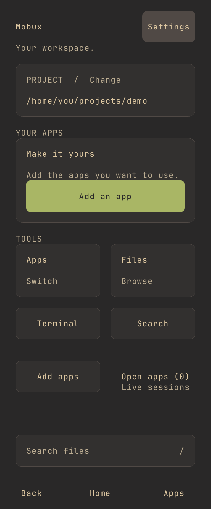
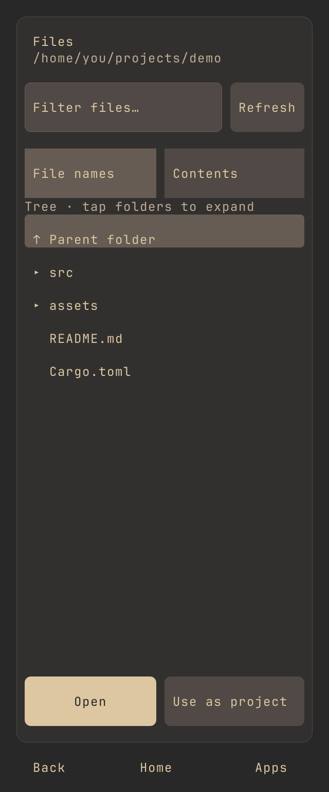

# Mobux

Mobux adds a touch-friendly workspace to Termux. Browse files, search a project, and switch between programs without closing them.

Termux runs the tools. tmux keeps them alive. Mobux provides navigation.

## Install

In Termux on Android 9 or newer:

```sh
pkg update
pkg install tmux ripgrep curl jq tar coreutils
curl -fLo install-mobux.sh https://raw.githubusercontent.com/h0rv/mobux/main/scripts/install-termux.sh
bash install-mobux.sh
mobux
```

The installer downloads a prebuilt binary and verifies its checksum. Phone support is experimental.

[Setup and keyboard guide](SETUP.md) · [Downloads](https://github.com/h0rv/mobux/releases)

## Preview

These are generated mobile layouts, not phone screenshots. Termux uses the cell renderer by default.

<p>
  
  
</p>

## Development

```sh
mise run check
mise run test-ui
```

Mobux is MIT licensed. [Asset credits](assets/THIRD_PARTY.md) and [theme sources](themes/THIRD_PARTY.md) cover third-party files.
