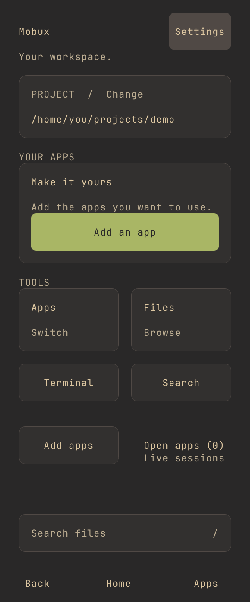
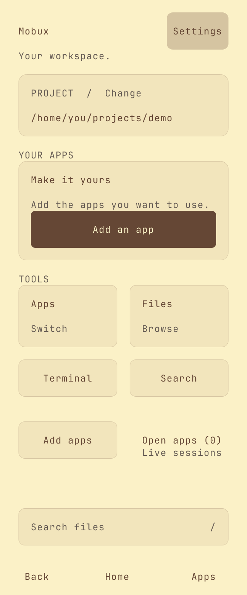
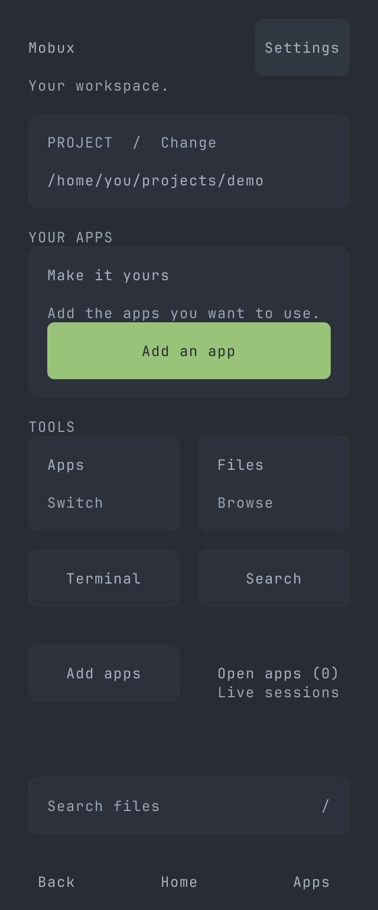
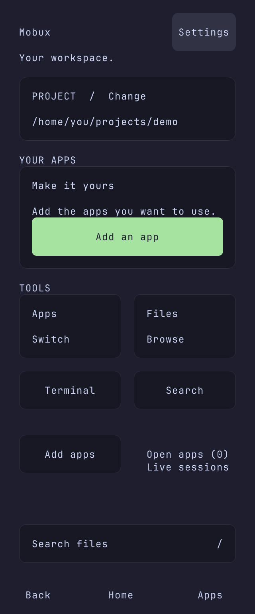
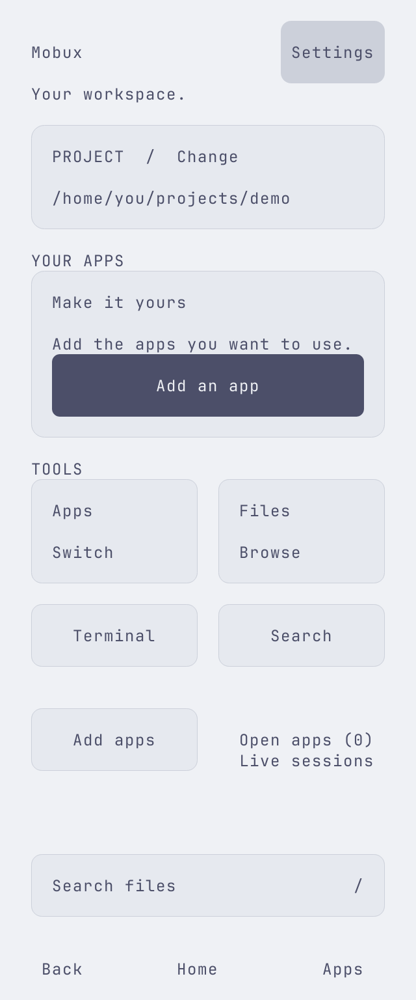
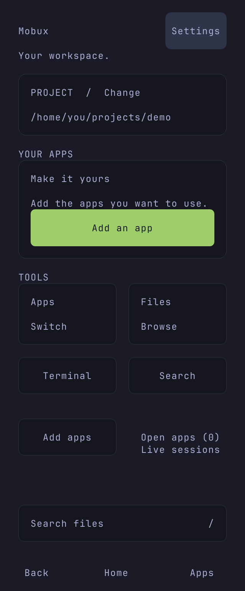

# Themes

Change Theme in Settings, or set `MOBUX_THEME` to one of the names below. Theme colors are independent of the Minimal, Android, and iPhone layouts.

These are generated 40 by 48 layouts, not phone screenshots. Native graphics require a compatible terminal. Termux uses the cell renderer by default.

## Gruvbox Material Dark

`MOBUX_THEME=gruvbox-material-dark mobux`

## Gruvbox Material Light

`MOBUX_THEME=gruvbox-material-light mobux`

## One Dark Pro

`MOBUX_THEME=one-dark-pro mobux`

## Catppuccin Mocha

`MOBUX_THEME=catppuccin-mocha mobux`

## Catppuccin Latte

`MOBUX_THEME=catppuccin-latte mobux`

## Tokyo Night

`MOBUX_THEME=tokyo-night-dark mobux`

## Custom palettes

`MOBUX_THEME=/path/to/theme.json mobux` loads a custom palette. Use the JSON structure in `themes/`. See [sources and licenses](../themes/THIRD_PARTY.md) for the bundled palettes.
